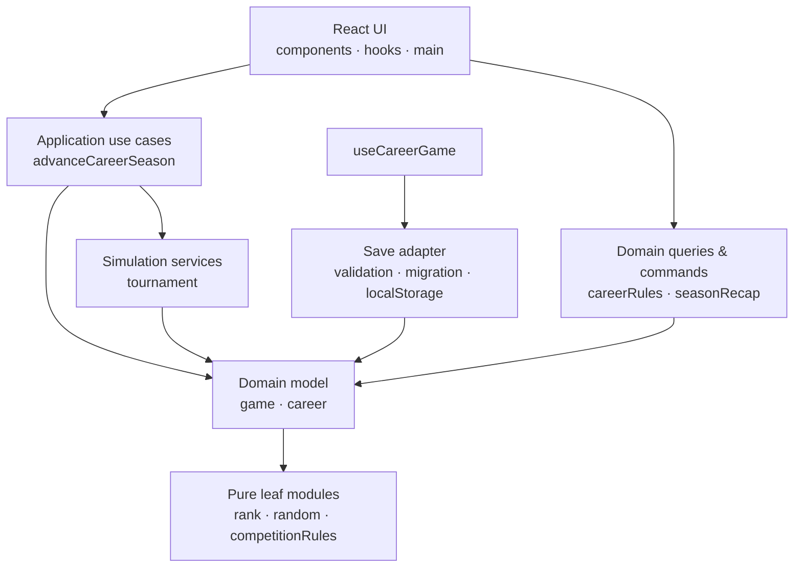
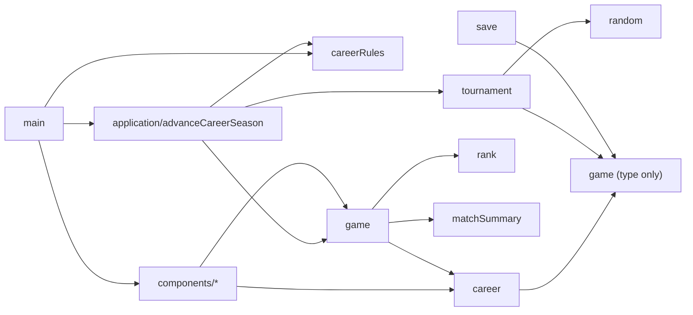
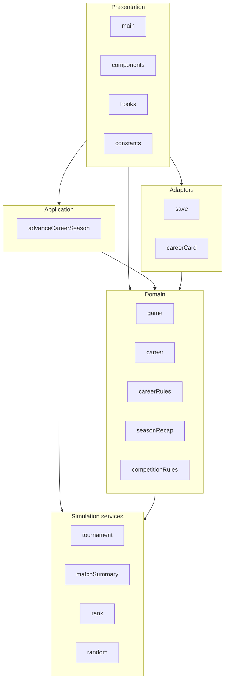

# 아키텍처와 모듈 설계

## 계층 아키텍처



의존성은 위에서 아래로만 흐른다. 화면은 시즌 전체 절차를 직접 조립하지 않고 애플리케이션 유스케이스를 호출한다. 엔진은 React·브라우저·애플리케이션 계층을 알지 못한다.

## 실행 의존성 그래프



점선으로 표현할 법한 `type only` 연결은 빌드 후 사라지는 타입 의존성이다. `scripts/check-architecture.mjs`는 이를 실행 간선에서 제외한 뒤 역방향 의존과 순환을 차단한다.

## 모듈 그래프와 책임



- `src/application/advanceCareerSeason.ts`: 참가 자격 확인 → 공식 대회 자동 진행 → 시즌 결산을 하나의 유스케이스로 조정한다.
- `src/engine/game.ts`: 커리어 상태와 원자적인 상태 전이를 제공한다.
- `src/engine/career.ts`: 통산 집계·은퇴·명예의 전당 규칙을 담당한다.
- `src/engine/careerRules.ts`: 대회·팀 진입 조건과 다음 목표를 계산하는 순수 정책이다.
- `src/engine/seasonProgress.ts`: 주차 진행, 시즌 전환과 RP 소프트 리셋을 담당한다.
- `src/engine/competitionProgress.ts`: KeG·KEL 참가 결과와 인지도·대회 이력을 갱신한다.
- `src/engine/roster.ts`: 주전 교체와 교체 비용을 담당한다.
- `src/engine/contracts.ts`: 재계약 상태 전이를 담당한다.
- `src/engine/tournament.ts`: 마스터즈·KEL 결과 시뮬레이션을 담당한다.
- `src/engine/save.ts`: 저장 데이터 검증·마이그레이션·기본값 보완을 담당한다.
- `src/components/*`: 정책을 계산하지 않고 상태와 유스케이스 결과를 표현한다.
- `src/hooks/useCareerGame.ts`: 브라우저 저장 수명주기와 UI 상태 연결만 맡는다.

## 객체지향과 함수형 경계

상태를 숨기고 여러 규칙을 일관되게 평가해야 하는 개념은 객체로 모델링한다. `HallOfFameCareer`는 한 커리어를 캡슐화하고 `progress()`와 `canReceive()`가 동일한 기준을 공유하게 한다. 외부에는 기존 함수형 API도 어댑터로 유지해 호출부와 저장 호환성을 보존한다.

단일 입력을 새 불변 상태로 바꾸는 게임 행동, 진입 조건, 집계는 순수 함수를 유지한다. 상속 계층은 만들지 않으며 조합과 명시적 타입을 우선한다. 이 기준은 객체를 늘리는 것이 아니라 응집도를 높이고 변경 범위를 줄이는 데 목적이 있다.

## 의존성 규칙

1. `engine`은 `application`, `components`, `hooks`를 가져올 수 없다.
2. `application`은 `components`, `hooks`를 가져올 수 없다.
3. 실행 의존성에 순환이 없어야 한다. 타입 전용 import는 실행 그래프에서 제외한다.
4. UI는 대회 컷·명성·헌액 기준을 중복 정의하지 않고 도메인 선택자를 사용한다.
5. 새 시즌 단위 절차는 `main.tsx`가 아니라 애플리케이션 유스케이스에 추가한다.

```bash
npm run architecture:check
```

## 저장 호환성

브라우저 키 `iron-to-fame-save-v1`을 유지하고 내부 `version`으로 스키마를 관리하며 현재 버전은 7이다. `migrateGameSave`는 알 수 없는 입력과 대회 이력의 각 항목을 검증하고 현재 버전의 필수 필드를 보완하며 공식 대회 이력에 맞지 않는 레거시 인지도를 안전한 범위로 교정한다. 가져온 JSON은 같은 마이그레이션을 거쳐 미리보기를 보여준 뒤 사용자가 적용할 때만 현재 커리어를 교체한다.

## 검증

```bash
npm run check
```

`check`는 형식, 아키텍처 방향, ESLint, TypeScript, 단위·UI 테스트와 배포 빌드를 검증한다. 자동 참가 유스케이스 테스트는 자격 미달 선수의 허위 출전을 막고, 자격을 갖춘 팀 선수의 마스터즈 일정이 한 번의 시즌 진행으로 완료되는지 확인한다.

## 변경 순서

1. 데이터 모델과 저장 마이그레이션을 함께 변경한다.
2. 도메인 정책과 테스트를 먼저 작성한다.
3. 여러 도메인 행동을 묶는 절차는 애플리케이션 계층에 둔다.
4. UI는 검증된 유스케이스와 선택자만 호출한다.
5. 아키텍처 그래프와 배포 문서를 같은 변경에서 갱신한다.
